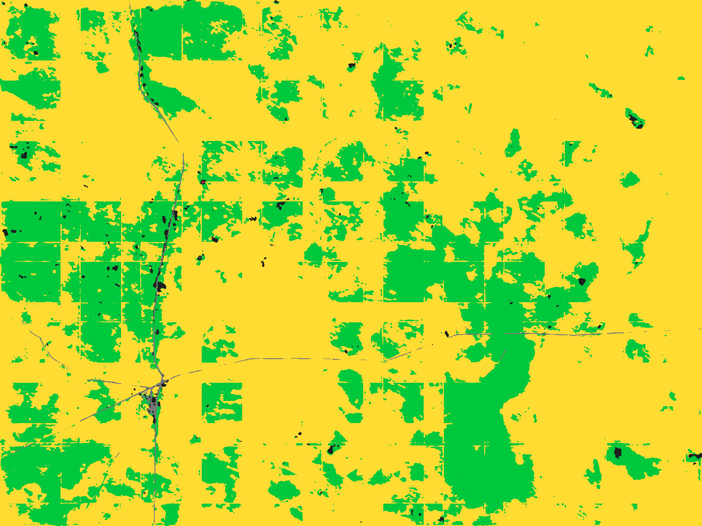
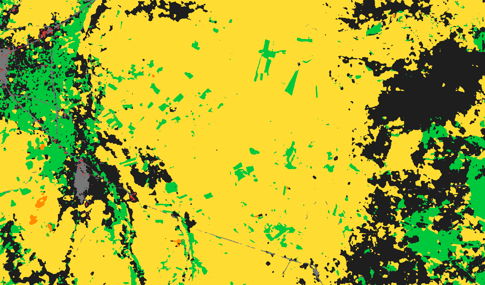
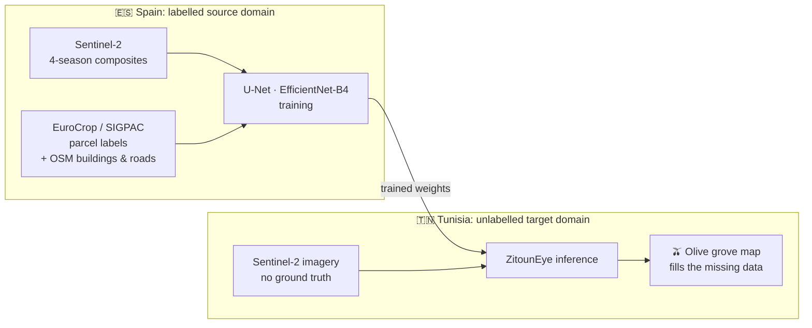
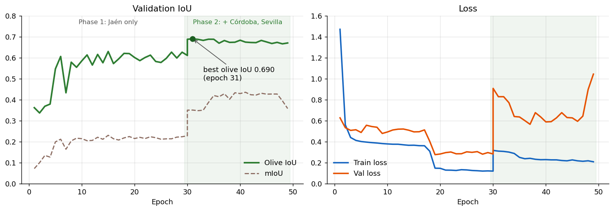
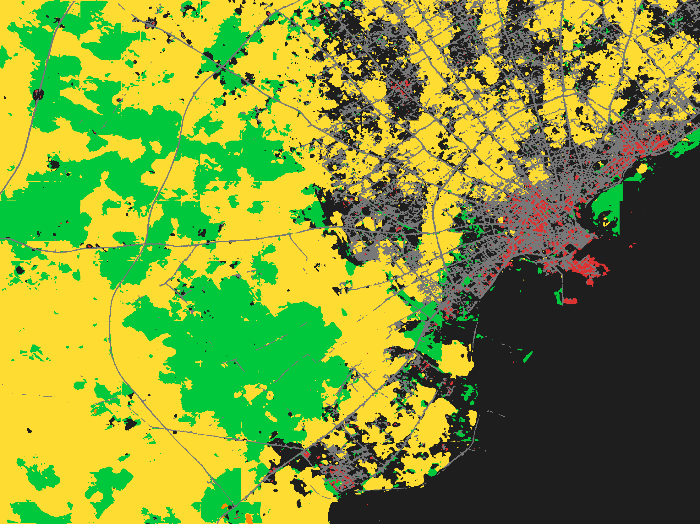
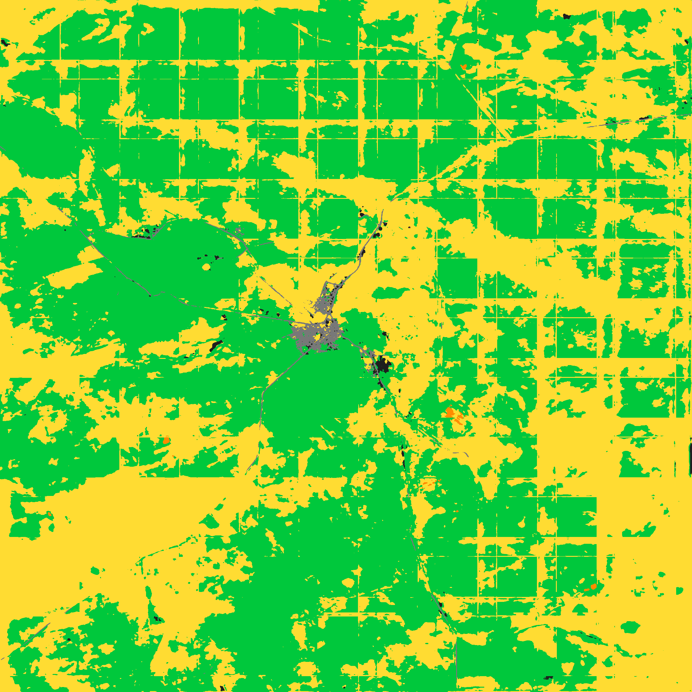
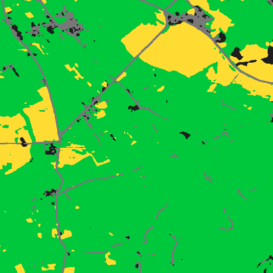

<h1 align="center">🫒 Zitoun Eye · عين الزيتون</h1>
<h3 align="center">Tunisia Olive Tree Detection: mapping Tunisia's olive groves with knowledge learned in Spain</h3>

<p align="center">
  
  
  
  
</p>

> **"Zitoun" (زيتون) means *olive* in Arabic, so Zitoun Eye means "the olive eye".**
> ZitounEye is a deep-learning model that looks at Sentinel-2 satellite imagery and labels every 10 m pixel as olive grove, vineyard, orchard, arable land, building, road or background.

<p align="center">
  
  
  <br/>
  <em>Left: Sfax, Tunisia (the model was never trained on Tunisian labels). Right: Jaén, Spain (the training domain). 🟢 = olive grove</em>
</p>

---

## 🎯 The problem: Tunisia has olives but no labels

Tunisia is one of the world's largest olive-oil producers, with **more than 1.8 million hectares of olive groves** (Sfax, Sousse, Mahdia, Kairouan and Sidi Bouzid). But to train a satellite model you need **ground truth**: maps that say exactly which parcel grows what. For Tunisia, that data is **missing**:

| | 🇪🇸 Spain | 🇹🇳 Tunisia |
|---|---|---|
| Free Sentinel-2 imagery | ✅ | ✅ |
| Official parcel-level crop map | ✅ **SIGPAC / EuroCrop**: every farm parcel with its declared crop, millions of polygons | ❌ **None publicly available** |
| Olive-growing climate | Mediterranean, semi-arid (Andalusia) | Mediterranean → semi-arid → arid |
| Crops that get confused with olives | Vineyards, almonds, cereals | Vineyards, almonds, cereals |

## 💡 The idea: borrow Spain's labels to fill Tunisia's gaps

Andalusia and Tunisia share the same tree, a similar climate and the same confuser crops. So ZitounEye:

1. **Learns what an olive grove looks like from space** in Spain, where millions of labelled parcels exist.
2. **Transfers that knowledge to Tunisia**, where no labels exist, and produces the olive map that is missing there.



The olive tree's "signature" is physical, not national. It is **evergreen**: green in every season, while vineyards go bare in winter and cereals die after the spring harvest. A model that learns this pattern in Jaén should find it again in Sfax.

| Crop | Spring | Summer | Fall | Winter | Pattern |
|---|---|---|---|---|---|
| **Olive** | 🟩 | 🟩 | 🟩 | 🟩 | **Always green (evergreen)** |
| Vineyard | 🟫 | 🟩 | 🟩 | 🟫 | Bare in winter |
| Wheat | 🟩 | 🟨 | 🟫 | 🟫 | Spring-only peak |

### Handling missing values on the Tunisian side

The model expects **56 input bands** (14 bands × 4 seasons). Tunisian scenes often don't have all of that, so the inference pipeline fills the gaps:

- **Missing spectral indices**: NDVI, EVI, NDWI and SAVI are computed on the fly from the 10 raw Sentinel-2 bands.
- **Missing seasons**: when only one cloud-free season is available, its 14-band composite is copied into all four seasonal slots, so the input still has the shape the model expects.
- **Missing labels**: the model labels Tunisian pixels itself. Its outputs are the olive map that doesn't otherwise exist, and they can later be used as *pseudo-labels* to fine-tune a Tunisia-specific model.

---

## 🧠 The model (latest release)

| | |
|---|---|
| **Checkpoint** | [`checkpoints/final_20260620_104109_best.pth`](checkpoints/) (238 MB, stored with Git LFS) |
| Architecture | U-Net + EfficientNet-B4 encoder (`segmentation-models-pytorch`) |
| Input | 56 bands = 14 (B2–B8A, B11, B12, NDVI, EVI, NDWI, SAVI) × 4 seasons, 10 m |
| Output | 7 classes, one per pixel |
| Training data | Jaén + Córdoba (train), Sevilla (validation): Sentinel-2 2023 + EuroCrop 2023 |
| Loss | Focal (γ = 2.5) + Dice, class-weighted (olive × 5) |
| Training | Phase 1: Jaén only, 30 epochs → Phase 2: + Córdoba & Sevilla, 19 more epochs |

### Classes

| ID | Class | Colour | Source |
|---|---|---|---|
| 0 | Background | ⬛ | forest, fallow, water, unknown |
| **1** | **Olive grove** | 🟩 | **EuroCrop codes 101, 349, 363** |
| 2 | Vineyard | 🟪 | EuroCrop (the main confuser crop) |
| 3 | Other orchard | 🟧 | almond, citrus, fig, carob… |
| 4 | Arable crop | 🟨 | wheat, barley, sunflower… |
| 5 | Building | 🟥 | OpenStreetMap |
| 6 | Road | ⬜ | OpenStreetMap |

### Training results



| Metric (Sevilla validation province, never trained on) | Value |
|---|---|
| **Olive grove IoU** (best, epoch 31) | **0.690** |
| Peak mean IoU across classes | 0.436 |
| Phase 1 → Phase 2 olive IoU gain | 0.63 → 0.69 |

Adding more provinces gave the clearest improvement, which supports the idea that more landscape diversity produces a model that transfers better.

---

## 🗺️ Results

### 🇹🇳 Tunisia: transfer with no Tunisian labels

| Sfax Governorate (rural Sahel olive belt) | Sfax city & peri-urban groves |
|---|---|
|  |  |
| **Tozeur (oasis / desert margin)** | **Mornag, Ben Arous (south of Tunis)** |
|  |  |

The Sfax region, one of the densest olive landscapes in the world, comes out as large, coherent olive (green) blocks, without any Tunisian training data.

### 🇪🇸 Spain: full 4-season input (best case)

| Jaén, window 0 | Jaén, window 1 (olive heartland) |
|---|---|
|  |  |

The georeferenced GeoTIFFs for all of these maps are in [`results/`](results/) and can be opened directly in **QGIS** or Google Earth.

Colours: 🟢 olive · 🟣 vineyard · 🟠 orchard · 🟡 arable · 🔴 building · ⚪ road · ⚫ background

---

## ⚠️ Honest limitations

- **No Tunisian ground truth yet.** The Tunisia results are checked by eye against known olive regions, not scored. Measuring accuracy needs a labelled Tunisian sample.
- **Single-season inference is weaker.** When one season is copied into all four slots, the model loses the evergreen signal it relies on most. Visible square tile seams in some Tunisian maps (e.g. Sfax) come from this and from the sliding-window patching.
- **Domain shift.** Tunisian soils are more calcareous and the climate is drier, and traditional Sfax groves are much sparser (~17–20 trees/ha) than Andalusian ones.
- The Huelva test province has not yet been scored with this checkpoint.

## 🛣️ Roadmap

- [ ] Download true **4-season** Sentinel-2 composites for Tunisian sites (removes the season-copying shortcut)
- [ ] Build a small **labelled Tunisian validation set** (field points / photo-interpretation) to measure transfer accuracy
- [ ] **Domain adaptation**: fine-tune on Tunisian pseudo-labels from high-confidence predictions
- [ ] Add more Spanish provinces (Granada, Málaga) for diversity, and score on Huelva
- [ ] Sentinel-1 SAR input for cloud-proof canopy-structure features
- [ ] National-scale olive map of Tunisia

---

## 🚀 Quick start

```bash
pip install -r requirements.txt
git lfs install && git lfs pull        # downloads the 238 MB model checkpoint
```

**Predict on a Sentinel-2 GeoTIFF**

```bash
# single-season scene (e.g. Tunisia): indices computed + season copied automatically
python scripts/predict.py --input my_scene.tif \
       --checkpoint checkpoints/final_20260620_104109_best.pth

# true 4-season stack
python scripts/predict_4season.py
```

**Interactive web app** (FastAPI + Leaflet: draw a box on the map and get the olive map back)

```bash
python src/backend/main.py      # API on http://localhost:8000
# then open src/frontend/index.html
```

> Some scripts still contain absolute Windows paths (`c:\Users\...\zitoun_eye`). Change `PROJECT_ROOT` to your own clone path.

**Re-train from scratch**

1. Download Sentinel-2 seasonal composites with Google Earth Engine using [`gee_download_sentinel2.js`](gee_download_sentinel2.js)
2. Get the EuroCrop 2023 Spain shapefiles (`ES_2023/`) and OSM extracts (`data/osm/`). These are not in the repo because of their size (~20 GB).
3. `python scripts/final_train.py`

## 📁 Repository layout

```
zitoun_eye/
├── checkpoints/final_20260620_104109_best.pth   ← latest model (Git LFS)
├── v1_tunisia_resnet34/                         ← previous Tunisia-only version (kept for reference)
├── results/                                     ← prediction GeoTIFFs (Spain + Tunisia)
├── research_paper/                              ← full write-up + figures
├── docs/images/                                 ← README figures
├── scripts/                                     ← data prep, training, inference
├── src/                                         ← dataset, losses, metrics, web backend/frontend
├── configs/default.yaml                         ← classes, bands, hyper-parameters
├── logs/                                        ← training histories (JSON)
├── gee_download_sentinel2.js                    ← Earth Engine export script
├── es_2023.csv, HCAT3.csv                       ← Spanish crop code → class mapping
└── explanation.md                               ← plain-language walkthrough of the pipeline
```

📄 The full methodology is in the [research paper](research_paper/ZitounEye_Research_Paper.md).

## 🕰️ Project history: v1 → v2

| | **v1**: Tunisia-only ([`v1_tunisia_resnet34/`](v1_tunisia_resnet34/)) | **v2**: ZitounEye, Spain → Tunisia (this release) |
|---|---|---|
| Training labels | ~5,300 hand-made / auto-generated Tunisian chips | Millions of official EuroCrop / SIGPAC parcels (Spain) |
| Classes | Extensive olive, intensive olive, background | 7 classes incl. vineyard & orchard confusers |
| Input | 14 bands, summer only, 128×128 | 56 bands (4 seasons), 256×256 |
| Model | U-Net + ResNet-34 | U-Net + EfficientNet-B4 |
| App | Flask upload app | FastAPI + Leaflet map app |

v1 showed how few reliable Tunisian labels there are, and that gap motivated v2: train where labels are plentiful (Spain) and transfer to where they are missing (Tunisia). The v1 code is kept unchanged in [`v1_tunisia_resnet34/`](v1_tunisia_resnet34/), and its weights are still on the Google Drive link in its README.

## 📜 Data sources & licences

- **Sentinel-2**: Copernicus Programme (ESA), free and open
- **EuroCrop / SIGPAC 2023**: CC-BY-4.0
- **OpenStreetMap**: © OpenStreetMap contributors, ODbL
