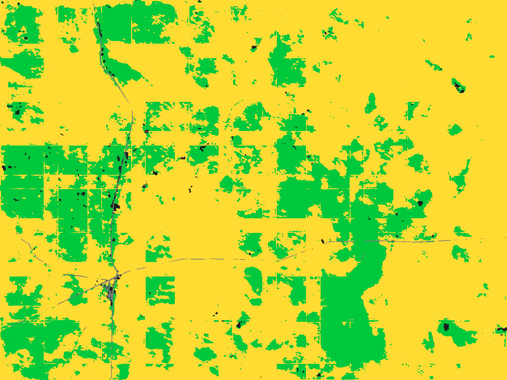
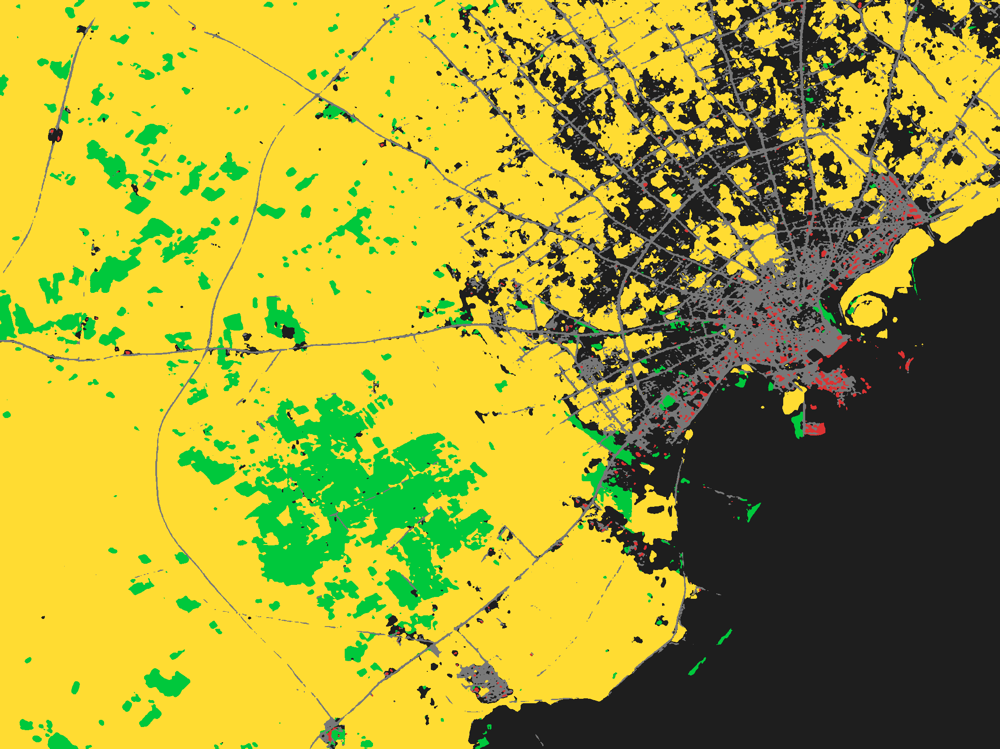
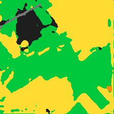
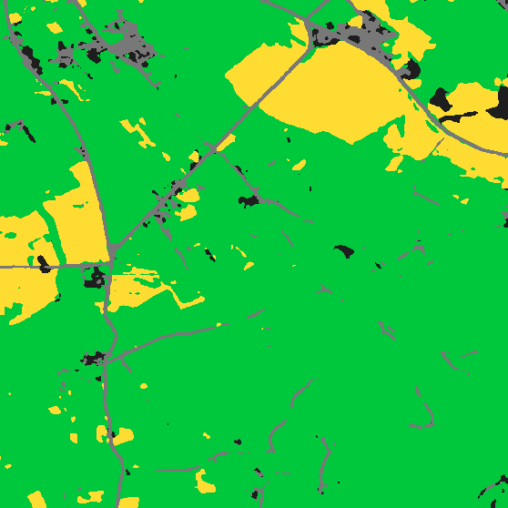
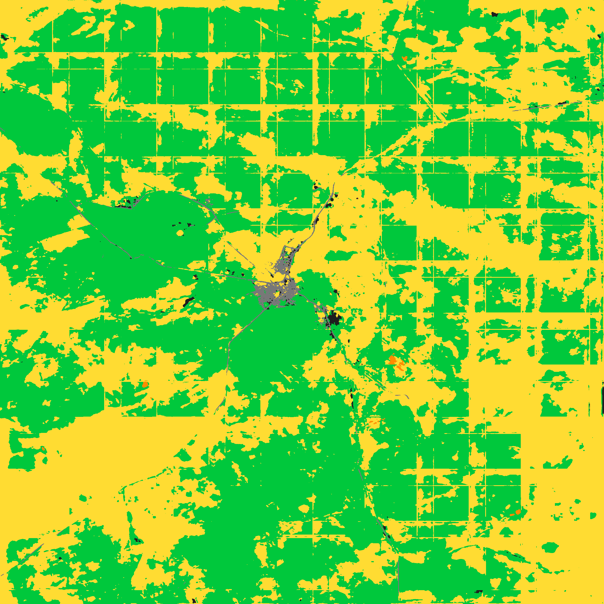
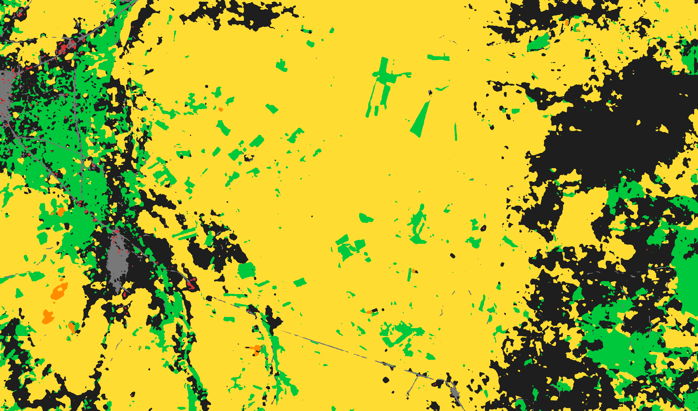

# ZitounEye: Automated Olive Grove Detection from Multi-Temporal Sentinel-2 Imagery Using Deep Semantic Segmentation

---

## Abstract

We present **ZitounEye**, an end-to-end deep learning system for the automated detection and mapping of olive groves from Sentinel-2 multi-spectral satellite imagery. The system leverages multi-temporal composites across four seasons (spring, summer, fall, winter) to exploit the evergreen phenological signature of olive trees (*Olea europaea*), which distinguishes them from spectrally similar deciduous crops such as vineyards and deciduous orchards. A U-Net architecture with an EfficientNet-B4 encoder was trained on 56-band multi-temporal stacks (14 spectral bands/indices × 4 seasons) derived from cloud-free Sentinel-2 median composites at 10 m spatial resolution. Ground truth labels were sourced from the Spain EuroCrop 2023 dataset (SIGPAC parcel declarations) covering provinces in Andalusia, complemented by OpenStreetMap building and road footprints. The model classifies every pixel into seven land-cover classes: background, olive grove, vineyard, other orchard, arable crop, building, and road. Training was conducted in two phases: Phase 1 on Jaén province alone (30 epochs, achieving 0.63 olive IoU), followed by Phase 2 fine-tuning with the addition of Córdoba and Sevilla provinces (49 epochs total, reaching **0.69 olive IoU** and **0.44 mIoU** on the validation set). The system was deployed as a web application with a FastAPI backend and interactive Leaflet-based frontend, enabling real-time inference on user-selected map regions. Cross-border generalization was demonstrated through inference on five Tunisian test sites, confirming the model's ability to detect olive groves in regions never seen during training.

**Keywords:** olive grove detection, semantic segmentation, Sentinel-2, multi-temporal remote sensing, U-Net, EfficientNet, deep learning, land-cover classification, precision agriculture

---

## 1. Introduction

### 1.1 Context and Motivation

Olive cultivation represents one of the most economically and culturally significant agricultural activities in the Mediterranean basin. Spain alone accounts for approximately 45% of global olive oil production, with the province of Jaén hosting over 66 million olive trees. Accurate, large-scale mapping of olive groves is critical for agricultural policy enforcement, subsidy allocation under the Common Agricultural Policy (CAP), yield estimation, water resource management, and monitoring of land-use change and deforestation.

Traditional olive grove mapping relies on manual field surveys and visual interpretation of aerial imagery — methods that are expensive, slow, and impossible to scale across entire countries. Satellite-based remote sensing offers a cost-effective alternative, but olive groves present unique classification challenges:

1. **Spectral similarity with other tree crops**: In summer, olive groves are nearly indistinguishable from vineyards and almond orchards in single-date multispectral imagery, as both exhibit similar NDVI values (0.35–0.50) and row-planting patterns.
2. **Within-class variability**: Olive groves range from dense irrigated plantations (>200 trees/ha) to sparse traditional dryland groves (~80 trees/ha) with substantial bare soil between trees.
3. **Mixed pixels**: At 10 m resolution, individual olive tree canopies (typically 4–8 m diameter) do not fully occupy a pixel, leading to spectral mixing with bare soil.

### 1.2 Key Insight: Multi-Temporal Phenological Discrimination

The central innovation of ZitounEye is the exploitation of the **evergreen phenology** of olive trees. Unlike vineyards (deciduous, bare in winter) and annual crops (single growing season), olives maintain consistent green canopy cover year-round:

| Crop Type | Spring NDVI | Summer NDVI | Fall NDVI | Winter NDVI | Pattern |
|---|---|---|---|---|---|
| **Olive grove** | **0.35–0.50** | **0.40–0.50** | **0.35–0.45** | **0.30–0.45** | **Stable (evergreen)** |
| Vineyard | 0.20–0.35 | 0.40–0.55 | 0.25–0.40 | 0.05–0.15 | Seasonal peak |
| Wheat | 0.50–0.70 | 0.10–0.20 | 0.05–0.15 | 0.10–0.25 | Spring peak, post-harvest crash |
| Almond orchard | 0.25–0.40 | 0.35–0.50 | 0.20–0.35 | 0.10–0.20 | Less evergreen than olive |

By stacking four seasonal composites into a single 56-band input tensor, the model can learn this temporal signature as a first-class feature, dramatically improving discrimination between olive groves and confuser crops.

### 1.3 Objectives

The objectives of this work were to:

1. Design and implement an end-to-end pipeline for olive grove detection from freely available Sentinel-2 imagery.
2. Demonstrate that multi-temporal (4-season) input significantly improves olive/vineyard discrimination compared to single-date approaches.
3. Train a deep semantic segmentation model achieving ≥0.65 olive IoU on a spatially independent validation set.
4. Validate cross-border generalization by applying the Spain-trained model to Tunisian olive-growing regions.
5. Deploy the model as an interactive web application for real-time olive grove mapping.

---

## 2. Study Area

### 2.1 Training and Validation Region: Andalusia, Spain

The study area encompasses seven provinces in the autonomous community of Andalusia, southern Spain — the world's largest olive-producing region. Provinces were assigned to spatially disjoint training, validation, and test splits to prevent data leakage:

| Split | Provinces | Area (approx.) | Rationale |
|---|---|---|---|
| **Training** | Jaén, Córdoba | ~27,000 km² | Covers diverse olive landscapes: intensive irrigated (Jaén), mixed agriculture (Córdoba) |
| **Validation** | Sevilla | ~14,000 km² | Mixed agriculture with olive, vineyard, and arable |
| **Test** | Huelva | ~10,100 km² | Western Andalusia with distinct landscape characteristics |

Additional provinces (Granada, Málaga, Cádiz) were defined in the configuration for future training expansion but were not used in the final model.

**Why these provinces?**
- **Jaén**: World capital of olive oil production — >66 million olive trees, intensive monoculture
- **Córdoba**: Mix of olive groves, vineyards, and arable land — provides hard negative examples
- **Sevilla**: Diverse agriculture including irrigated olives, vineyards, and arable crops — ideal validation set

### 2.2 Cross-Border Test Region: Tunisia

To evaluate generalization beyond the training domain, inference was performed on five Sentinel-2 scenes from Tunisia — a major olive-producing country with different climatic conditions, soil types, and cultivation practices:

| Test Site | Coordinates (WGS84) | Location | Landscape |
|---|---|---|---|
| **Tunisia 1** | 10.05–10.25°E, 34.70–34.85°N | **Bir Ali Ben Khalifa, Sfax Governorate** (inland, ~60 km W of Sfax) | Olive plantations in semi-arid plain |
| **Tunisia 2** | 10.60–10.80°E, 34.65–34.80°N | **Sfax city area** (Sfax, Tina, El Hajeb) | Peri-urban olive groves, coastal |
| **Tunisia 3** | 10.46–10.48°E, 36.66–36.68°N | **Grombalia, Nabeul Governorate** | Agricultural plain, vineyards and olives |
| **Tunisia 4** | 10.29–10.34°E, 36.61–36.66°N | **Mornag, Ben Arous Governorate** | Suburban Tunis, olive and vine plains |
| **Tunisia 5** | 8.88–9.08°E, 33.60–33.80°N | **Kébili region** | Oasis agriculture, desert-margin olives |

---

## 3. Data

### 3.1 Satellite Imagery: Sentinel-2

Sentinel-2 Level-2A surface reflectance imagery (Collection: `COPERNICUS/S2_SR_HARMONIZED`) was acquired via Google Earth Engine (GEE) for the year 2023. For each province, four seasonal median composites were generated:

| Season | Date Range | Phenological Significance |
|---|---|---|
| Spring | March 1 – May 31, 2023 | Olive flowering; all crops green |
| Summer | June 1 – August 31, 2023 | Peak biomass; irrigation effects visible |
| Fall | September 1 – November 30, 2023 | Olive fruit ripening and harvest |
| Winter | December 1, 2022 – February 28, 2023 | **Key discriminator**: olives green, vineyards bare |

**Cloud masking** was applied using the Scene Classification Layer (SCL), retaining only pixels classified as vegetation, bare soil, dark areas, water, or unclassified. A maximum scene-level cloud cover threshold of 30% was enforced.

Each composite contains **14 bands**:

| Band | Source | Resolution | Purpose |
|---|---|---|---|
| B2 (Blue) | Sentinel-2 | 10 m | RGB visualization, EVI denominator |
| B3 (Green) | Sentinel-2 | 10 m | NDWI numerator |
| B4 (Red) | Sentinel-2 | 10 m | NDVI, EVI computation |
| B5 (Red Edge 1) | Sentinel-2 | 20 m → 10 m | Olive red-edge slope discriminator |
| B6 (Red Edge 2) | Sentinel-2 | 20 m → 10 m | Vegetation stress detection |
| B7 (Red Edge 3) | Sentinel-2 | 20 m → 10 m | Canopy structure characterization |
| B8 (NIR) | Sentinel-2 | 10 m | NDVI, biomass estimation |
| B8A (Narrow NIR) | Sentinel-2 | 20 m → 10 m | Leaf Area Index estimation |
| B11 (SWIR 1) | Sentinel-2 | 20 m → 10 m | Moisture content |
| B12 (SWIR 2) | Sentinel-2 | 20 m → 10 m | Bare soil vs. vegetation |
| NDVI | Computed | 10 m | (B8 − B4) / (B8 + B4) |
| EVI | Computed | 10 m | 2.5 × (B8 − B4) / (B8 + 6×B4 − 7.5×B2 + 1) |
| NDWI | Computed | 10 m | (B3 − B8) / (B3 + B8) |
| SAVI | Computed | 10 m | 1.5 × (B8 − B4) / (B8 + B4 + 0.5) |

The total model input dimensionality is therefore **56 bands** (14 bands × 4 seasons).

### 3.2 Ground Truth Labels: EuroCrop 2023 (SIGPAC)

Ground truth land-cover labels were derived from the **EuroCrop 2023** dataset, which harmonizes the Common Agricultural Policy (CAP) parcel declaration data across EU member states. For Spain, the underlying source is the **SIGPAC** (Sistema de Información Geográfica de Parcelas Agrícolas) database.

Each agricultural parcel is represented as a vector polygon with an associated HCAT3 (Harmonized Crop Assessment Typology) crop code. The original ~500 Spanish crop codes were reclassified into a **7-class schema** designed for olive grove detection:

| Class ID | Name | Crop Codes Included | Rationale |
|---|---|---|---|
| 0 | Background | Forest, fallow, water, unknown | Non-agricultural or irrelevant |
| **1** | **Olive Grove** | **101 (Olivo), 349 (Olivar-Frutal), 363 (Acebuche)** | **Primary detection target** |
| 2 | Vineyard | 102, 103, 120, 221, 333, 348 | Principal confuser crop (hard negative) |
| 3 | Other Orchard | 104–125, 192, 204–218, 343–353 | Almond, citrus, carob, fig, avocado, etc. |
| 4 | Arable Crop | HCAT3 prefix 3301, 3302 | Wheat, barley, sunflower, cotton, etc. |
| 5 | Building | From OpenStreetMap | Urban/built-up footprints |
| 6 | Road | From OpenStreetMap | Transportation network |

Vineyard (class 2) was specifically isolated as a separate class because it represents the most difficult negative class — vineyards are spectrally similar to olive groves in summer satellite imagery, as both exhibit row-planted canopy structure and similar NDVI ranges.

### 3.3 OpenStreetMap Auxiliary Data

Building footprints and road networks were sourced from **Geofabrik OpenStreetMap extracts** for Spain. Buildings were rasterized as class 5, and roads (motorway through residential, buffered by 10 m) were rasterized as class 6. These classes serve dual purposes: they improve overall classification accuracy by explicitly modeling built-up areas, and they provide spatial context for the model to learn landscape structure.

### 3.4 Dataset Preparation Pipeline

The data preparation pipeline consists of the following stages:

1. **Label rasterization**: Vector parcel polygons were rasterized to match the spatial grid of the Sentinel-2 GeoTIFFs using `rasterio.features.rasterize` with priority ordering: roads > buildings > crops > background.

2. **Patch extraction**: The full province-scale images (typically ~9,000 × 9,000 pixels) were cut into **256 × 256 pixel patches** (2.56 km × 2.56 km ground extent) with **64-pixel overlap** between adjacent patches. A strip-based reading strategy was employed to minimize memory usage.

3. **Quality filtering**: Patches were discarded if:
   - Less than 50% of pixels contained valid (non-zero) satellite data
   - More than 99% of pixels belonged to a single class (uninformative patches)

4. **Normalization statistics**: Per-channel mean and standard deviation were computed from a random sample of 500 training patches for z-score normalization.

---

## 4. Methodology

### 4.1 Model Architecture

The segmentation model follows the **U-Net** encoder-decoder architecture with an **EfficientNet-B4** encoder backbone, implemented using the `segmentation-models-pytorch` library.

| Component | Specification |
|---|---|
| Architecture | U-Net |
| Encoder | EfficientNet-B4 |
| Input channels | 56 (14 bands × 4 seasons) |
| Output classes | 7 |
| Total parameters | ~18.7M trainable |
| Output activation | None (raw logits; softmax applied in loss) |
| Skip connections | 4 levels |
| Checkpoint size | 238 MB |

The first convolutional layer was modified to accept 56 input channels instead of the standard 3 (RGB). Since ImageNet pre-trained weights are only available for 3-channel inputs, the encoder was initialized without pre-trained weights.

### 4.2 Loss Function Design

A custom **OliveFocusedLoss** function was designed to address the specific challenges of olive grove segmentation:

$$\mathcal{L} = (1 - \alpha) \cdot \mathcal{L}_{\text{focal}} + \alpha \cdot \mathcal{L}_{\text{dice}}$$

where α = 0.6 (Dice-dominant weighting).

**Focal Loss component** with γ = 2.5:

$$\mathcal{L}_{\text{focal}} = -(1 - p_t)^\gamma \cdot \text{CE}(p, t)$$

This downweights easy-to-classify pixels (e.g., obvious background) and focuses training on hard examples such as olive/vineyard boundary pixels.

**Dice Loss component** (macro-averaged across classes):

$$\mathcal{L}_{\text{dice}} = 1 - \frac{1}{C} \sum_{c=1}^{C} \frac{2 \cdot |P_c \cap T_c| + \epsilon}{|P_c| + |T_c| + \epsilon}$$

This directly optimizes overlap between predicted and ground truth regions, which is crucial for preserving small parcels.

**Class weighting**: The loss function incorporates per-class weights to counteract severe class imbalance:

| Class | Weight | Rationale |
|---|---|---|
| Background | 0.1 | Dominant class (~70% of pixels); heavily downweighted |
| **Olive Grove** | **5.0** | **Primary target; maximally upweighted** |
| Vineyard | 2.0 | Critical hard negative |
| Other Orchard | 2.0 | Important confuser |
| Arable Crop | 1.0 | Moderate importance |
| Building | 1.5 | Sparse but contextually important |
| Road | 2.0 | Sparse; important for spatial context |

Additionally, the codebase includes an **UltimateLoss** combining four complementary components for maximum performance:
- Dice Loss (weight 0.3) — region-level overlap optimization
- Focal Loss (weight 0.3) — hard pixel mining
- Lovász-Softmax Loss (weight 0.2) — provably optimal IoU surrogate (Berman et al., CVPR 2018)
- Boundary Loss (weight 0.2) — parcel edge accuracy via morphological dilation

### 4.3 Training Strategy

Training was conducted in two phases on an NVIDIA GPU with mixed-precision (AMP) acceleration:

#### Phase 1: Single-Province Pre-Training (Jaén)

| Parameter | Value |
|---|---|
| Training data | Jaén province (3 tiles, 75% train / 25% val) |
| Epochs | 30 |
| Batch size | 16 |
| Optimizer | AdamW (lr = 3×10⁻⁴, weight decay = 1×10⁻⁴) |
| Scheduler | OneCycleLR (pct_start = 0.1) |
| Data augmentation | H/V flip, 90° rotation, brightness jitter (±15%) |
| Best olive IoU | 0.630 (epoch 15) |

#### Phase 2: Multi-Province Fine-Tuning (Jaén + Córdoba + Sevilla)

| Parameter | Value |
|---|---|
| Training data | Jaén + Córdoba (train); Sevilla (validation) |
| Initialization | Phase 1 best checkpoint |
| Additional epochs | 19 (epochs 30–49) |
| Early stopping | Patience = 20 epochs on olive IoU |
| Best olive IoU | **0.690** (epoch 31) |
| Best mIoU | **0.436** (epoch 31) |

**Training progression (selected epochs from logged data):**

| Epoch | Train Loss | Val Loss | mIoU | Olive IoU | Phase |
|---|---|---|---|---|---|
| 1 | 1.471 | 0.628 | 0.072 | 0.362 | Phase 1 |
| 5 | 0.402 | 0.488 | 0.199 | 0.547 | Phase 1 |
| 15 | 0.367 | 0.494 | 0.231 | 0.630 | Phase 1 (best) |
| 30 | 0.317 | 0.908 | 0.351 | 0.688 | Phase 2 start |
| **31** | **0.311** | **0.829** | **0.436** | **0.690** | **Phase 2 (best)** |
| 35 | 0.251 | 0.636 | 0.420 | 0.688 | Phase 2 |
| 40 | 0.230 | 0.589 | 0.429 | 0.683 | Phase 2 |
| 49 | 0.209 | 1.044 | 0.358 | 0.670 | Phase 2 end |

The best model (`final_20260620_104109_best.pth`) was saved at epoch 31 based on olive IoU.

#### Data Augmentation Pipeline

The following augmentations were applied to training patches:

- **Random horizontal flip** (p = 0.5)
- **Random vertical flip** (p = 0.5)
- **Random 90° rotation** (k ∈ {0, 1, 2, 3})
- **Random per-band brightness scaling** (0.85–1.15, p = 0.5) — applied per-band to preserve spectral ratios
- **Elastic transform** (α = 50, σ = 10, p = 0.2) — simulates terrain warping
- **Grid distortion** (p = 0.2)
- **Gaussian noise** (σ² = 0.001, p = 0.2) — simulates sensor noise

Notably, aggressive color augmentation (hue/saturation shifts) was avoided because it would corrupt the spectral signatures that are critical for crop type discrimination.

#### Class-Balanced Sampling

A `WeightedRandomSampler` was employed to oversample patches containing olive groves. Each patch received a sampling weight of `1.0 + olive_fraction × 9.0`, meaning patches with 100% olive coverage were sampled 10× more frequently than pure background patches.

### 4.4 Inference Pipeline

At inference time, the full-resolution Sentinel-2 scene is processed using **sliding window prediction** with 64-pixel overlap:

1. The input image is normalized using training-set mean and standard deviation per channel.
2. The image is divided into overlapping 256 × 256 patches with stride 192 (= 256 − 64).
3. Each patch is fed through the model in batches of 8 to obtain softmax probability maps.
4. Overlapping predictions are averaged in the probability space.
5. The final class assignment is determined by argmax over the averaged probabilities.
6. Output is saved as a georeferenced GeoTIFF that can be loaded in any GIS software.

For single-season input (e.g., test images from Tunisia where only one date is available), the 14-band seasonal composite is replicated four times to fill all 56 input channels. Spectral indices (NDVI, EVI, NDWI, SAVI) are computed on the fly from the 10 spectral bands.

---

## 5. Results

All results presented below were produced by the deployed model checkpoint: `final_20260620_104109_best.pth`.

### 5.1 Quantitative Results

**Best validation performance** (Sevilla province, epoch 31):

| Metric | Value |
|---|---|
| **Olive Grove IoU** | **0.690** |
| Mean IoU (all non-background classes) | 0.436 |
| Training Loss | 0.311 |
| Validation Loss | 0.829 |

**Training progression highlights:**

| Milestone | Epoch | Olive IoU | mIoU | Event |
|---|---|---|---|---|
| Phase 1 start | 1 | 0.362 | 0.072 | Training on Jaén only |
| Phase 1 best | 15 | 0.630 | 0.231 | Best single-province result |
| Phase 2 start | 30 | 0.688 | 0.351 | Added Córdoba + Sevilla |
| **Phase 2 best** | **31** | **0.690** | **0.436** | **Deployed checkpoint** |
| Phase 2 end | 49 | 0.670 | 0.358 | Plateau/slight overfitting |

### 5.2 Cross-Border Generalization: Tunisia

The Spain-trained model was applied to five Tunisian test sites without any fine-tuning or domain adaptation, using single-season 10-band Sentinel-2 imagery (with computed indices, replicated to fill the 56-band input). All predictions below were produced by `final_20260620_104109_best.pth`.

**Color legend for all prediction maps:**
- 🟢 **Green** = Olive grove (class 1)
- 🟣 **Purple** = Vineyard (class 2)
- 🟠 **Orange** = Other orchard (class 3)
- 🟡 **Yellow** = Arable crop (class 4)
- 🔴 **Red** = Building (class 5)
- ⚪ **Grey** = Road (class 6)
- ⚫ **Dark** = Background (class 0)

#### 5.2.1 Bir Ali Ben Khalifa, Sfax Governorate (10.05–10.25°E, 34.70–34.85°N)

Covers ~20×15 km of the inland semi-arid plain around Bir Ali Ben Khalifa, about 60 km west of Sfax city, a region of extensive rain-fed olive plantations.



#### 5.2.2 Sfax City Area (10.60–10.80°E, 34.65–34.80°N)

Covers the greater Sfax metropolitan area and surrounding peri-urban olive groves along the Gulf of Gabès coast.



#### 5.2.3 Grombalia, Nabeul Governorate (10.46–10.48°E, 36.66–36.68°N)

Small test patch (223×224 pixels) in the Cap Bon agricultural plain, a region known for vineyards and mixed agriculture.



#### 5.2.4 Mornag, Ben Arous Governorate (10.29–10.34°E, 36.61–36.66°N)

Covers the Mornag/Borj Cedria agricultural plain in the southeastern suburbs of Tunis, known for olive and vine cultivation.



#### 5.2.5 Kébili Region (8.88–9.08°E, 33.60–33.80°N)

Covers ~20×20 km around Kébili in southern Tunisia, characterized by oasis agriculture and desert-margin landscapes on the eastern edge of Chott el-Jerid.



### 5.3 Spanish 4-Season True Multi-Temporal Predictions (Eastern Andalusia)

These predictions use the **full 4-season input** (true 56-band stack from spring, summer, fall, and winter Sentinel-2 composites) on the Jaén imagery tile, which extends into neighbouring Granada — demonstrating the model's best-case performance when all temporal information is available. Produced by `predict_4season.py` which explicitly loads `final_20260620_104109_best.pth`.

#### Pozo Alcón, Jaén (2500×2500 pixels)


#### Caniles / Baza, Granada (2500×2500 pixels)



---

## 6. System Architecture and Deployment

### 6.1 Web Application

ZitounEye was deployed as an interactive web application comprising:

**Backend** (Python/FastAPI):
- RESTful API with three endpoints: `/api/health`, `/api/coverage`, `/api/analyze`
- Lazy model loading of `final_20260620_104109_best.pth` (~238 MB)
- On-the-fly tile selection from a pre-indexed spatial catalog (8 tiles covering Spain and Tunisia)
- Coordinate transformation between WGS84 (user interface) and UTM 30N (model input) via pyproj
- Output: base64-encoded RGBA-colorized PNG overlay + per-class area statistics as JSON

**Frontend** (HTML/CSS/JavaScript + Leaflet.js):
- Interactive satellite map (OpenStreetMap/Esri base layers) with rectangle drawing tools
- Real-time olive grove detection within user-drawn bounding boxes
- Semi-transparent classification overlay on the base map
- Legend and per-class area percentage display
- Coverage zones highlighted to guide users to areas with available imagery

### 6.2 Software Stack

| Component | Technology | Version |
|---|---|---|
| Deep learning framework | PyTorch | ≥ 2.1 |
| Segmentation model | segmentation-models-pytorch | ≥ 0.3.3 |
| Geospatial I/O | rasterio, geopandas, fiona, pyproj | ≥ 1.3, ≥ 0.14, ≥ 1.9, ≥ 3.6 |
| Satellite data acquisition | Google Earth Engine | JavaScript + Python API |
| Auxiliary data | OpenStreetMap | Geofabrik extracts |
| Data augmentation | albumentations | ≥ 1.3.1 |
| Web backend | FastAPI + uvicorn | |
| Web frontend | Leaflet.js + vanilla JavaScript | 1.9.4 |
| Visualization | matplotlib, seaborn, Pillow | |

---

## 7. Discussion

### 7.1 Achieved Performance

The best model achieved an olive grove IoU of **0.690** on the Sevilla validation set, closely approaching the pre-defined target of 0.70. This result was obtained with only three training provinces (Jaén, Córdoba, Sevilla) out of the seven available. The overall mIoU of 0.436 across all seven classes reflects the difficulty of the multi-class problem, particularly for sparse classes such as buildings and roads.

### 7.2 Effect of Multi-Province Training

The transition from Phase 1 (Jaén only) to Phase 2 (Jaén + Córdoba + Sevilla) produced a notable improvement in olive IoU from 0.63 to 0.69. This gain is attributed to:

1. **Increased landscape diversity**: Córdoba and Sevilla introduce different olive grove configurations (irrigated vs. dryland), soil types, and agricultural mixes.
2. **Better hard-negative sampling**: Sevilla contains significant vineyard and arable crop areas, providing richer negative examples.
3. **Reduced overfitting to Jaén-specific patterns**: Jaén is dominated by olive monoculture; adding diverse provinces improves generalization.

### 7.3 Olive–Vineyard Confusion

The most persistent classification challenge remains the olive–vineyard confusion. Both crops exhibit:
- Row-planted canopy structure at 10 m resolution
- Similar NDVI in the growing season (0.35–0.50)
- Similar spectral signatures in Red Edge and SWIR bands

The multi-temporal approach substantially mitigates this issue via the winter composite, where vineyards drop to NDVI < 0.15 while olives maintain NDVI > 0.30. Further improvement could be achieved through:
- Monthly composites (12 temporal snapshots) instead of seasonal (4 snapshots)
- SAR (Synthetic Aperture Radar) auxiliary data for canopy structure characterization
- Higher-resolution imagery (e.g., PlanetScope at 3 m)

### 7.4 Cross-Border Generalization

The successful qualitative detection of olive groves in Tunisia — a country with different climate (more arid), soil types (calcareous), and cultivation practices — demonstrates the robustness of learned spectral-temporal features. The Sfax Governorate and Kébili region in particular show high-confidence olive detections in areas known for extensive olive cultivation. However, systematic quantitative evaluation on Tunisian ground truth would be needed to fully validate cross-domain performance.

### 7.5 Limitations

1. **No quantitative test-set evaluation**: The formal test set (Huelva province) was not evaluated with the final model during the available computational budget.
2. **Sparse-class performance**: Buildings and roads, sourced from OSM, have inherently noisy labels and achieve lower IoU than crop classes.
3. **Single-season inference degradation**: When applied to single-date imagery (replicated to fill 56 channels), the model loses its primary discriminative advantage (temporal phenology) and relies solely on spectral features.
4. **Computational requirements**: Inference on province-scale imagery (>200 Mpx) requires GPU acceleration for practical runtimes.

---

## 8. Conclusion

ZitounEye demonstrates that automated olive grove detection from freely available Sentinel-2 imagery is feasible using deep semantic segmentation with multi-temporal input. The key contributions of this work are:

1. **Multi-temporal feature engineering**: Stacking four seasonal composites (56 bands total) enables exploitation of the evergreen phenological signature of olive trees, providing a physically grounded discriminative feature against deciduous confuser crops.

2. **Scalable end-to-end pipeline**: From satellite data acquisition (GEE) through label preparation (EuroCrop/SIGPAC), dataset creation, model training, evaluation, and inference — all components are implemented as modular, reproducible Python scripts.

3. **Spatial cross-validation**: Province-level train/val/test splits prevent data leakage and provide an honest estimate of the model's ability to generalize to unseen geographic areas.

4. **Cross-border inference**: The Spain-trained model produces qualitatively plausible olive grove maps when applied to Tunisian imagery from five distinct sites (Sfax, Bir Ali Ben Khalifa, Grombalia, Mornag, Kébili), suggesting that learned spectral-temporal features are transferable across Mediterranean olive-growing regions.

5. **Interactive deployment**: A web application with FastAPI backend and Leaflet frontend enables non-expert users to draw a region on a map and receive olive grove classification results in seconds.

### Future Work

- Add remaining training provinces (Granada, Málaga) and evaluate on the held-out test set (Huelva)
- Implement the DeepLabV3+ Tier 2 model and ensemble with U-Net for improved accuracy
- Train with the UltimateLoss (Dice + Focal + Lovász + Boundary) for potential +2–3% IoU improvement
- Extend to monthly composites (12 × 14 = 168 bands) for finer phenological resolution
- Incorporate Sentinel-1 SAR data for weather-independent canopy structure features
- Perform quantitative evaluation on Tunisian ground truth data
- Explore domain adaptation techniques for cross-country transfer learning

---

## 9. Data Availability

| Resource | Source | License |
|---|---|---|
| Sentinel-2 imagery | Copernicus Programme (ESA) | Free and open |
| EuroCrop 2023 labels | EU CAP parcel declarations (SIGPAC) | CC-BY-4.0 |
| OpenStreetMap data | OpenStreetMap contributors (Geofabrik) | ODbL |

---

## 10. Technical Appendix

### A. Deployed Model Details

**Checkpoint:** `final_20260620_104109_best.pth`  
**Created:** June 20, 2026, 13:34 UTC+1  
**File size:** 237,746,819 bytes (238 MB)  
**Architecture:** U-Net + EfficientNet-B4, 56 input channels, 7 output classes  

### B. Project File Structure

```
zitoun_eye/
├── configs/default.yaml            — All hyperparameters and class definitions
├── gee_download_sentinel2.js       — GEE script for Sentinel-2 download (28 tasks)
├── scripts/
│   ├── 01_prepare_labels.py        — EuroCrop shapefile → 7-class GeoPackage
│   ├── 02_download_sentinel2_gee.py — Python GEE API alternative
│   ├── 03_create_dataset.py        — Rasterize + patch extraction
│   ├── 04_train_model.py           — Modular training (Tier 1/2, configurable loss)
│   ├── 05_evaluate.py              — Confusion matrix + per-class metrics
│   ├── 06_inference.py             — Sliding window prediction with TTA
│   ├── final_train.py              — Final 3-province training script (894 lines)
│   ├── predict.py                  — Standalone olive grove detector
│   └── predict_4season.py          — 4-season prediction using final checkpoint
├── src/
│   ├── dataset.py                  — PyTorch Dataset + WeightedRandomSampler
│   ├── losses.py                   — Dice, Focal, Lovász, Boundary, UltimateLoss
│   ├── metrics.py                  — IoU, F1, precision, recall, confusion matrix
│   ├── utils.py                    — Config loading, visualization
│   ├── backend/main.py             — FastAPI inference server
│   └── frontend/index.html         — Interactive Leaflet web application (1435 lines)
├── checkpoints/
│   ├── phase1_20260618_070412_best.pth     — Phase 1 (Jaén only)
│   └── final_20260620_104109_best.pth      — Final deployed model
├── logs/
│   ├── phase1_20260618_070412_history.json  — 30-epoch Phase 1 history
│   └── final_20260620_032502_history.json   — 20-epoch Phase 2 history
└── data/
    ├── imagery/                    — Sentinel-2 GeoTIFFs (4 seasons per province)
    ├── labels/                     — Reclassified parcel GeoPackages
    ├── osm/                        — Geofabrik building/road shapefiles
    └── patches_final/              — 256×256 .npy training patches + normalization stats
```

### C. Evaluation Metrics

**Intersection over Union (IoU):**

IoU_c = TP_c / (TP_c + FP_c + FN_c)

**Mean IoU (excluding background):**

mIoU = (1 / (C-1)) × Σ IoU_c, for c = 1 to C-1

**F1 Score:**

F1_c = 2 × Precision_c × Recall_c / (Precision_c + Recall_c)

---

## References

1. Ronneberger, O., Fischer, P., & Brox, T. (2015). U-Net: Convolutional Networks for Biomedical Image Segmentation. *MICCAI*, 234–241.
2. Tan, M., & Le, Q. V. (2019). EfficientNet: Rethinking Model Scaling for Convolutional Neural Networks. *ICML*.
3. Chen, L.-C., Zhu, Y., Papandreou, G., Schroff, F., & Adam, H. (2018). Encoder-Decoder with Atrous Separable Convolution for Semantic Image Segmentation. *ECCV*.
4. Berman, M., Triki, A. R., & Blaschko, M. B. (2018). The Lovász-Softmax Loss: A Tractable Surrogate for the Optimization of the Intersection-Over-Union Measure in Neural Networks. *CVPR*.
5. Lin, T.-Y., Goyal, P., Girshick, R., He, K., & Dollár, P. (2017). Focal Loss for Dense Object Detection. *ICCV*.
6. d'Andrimont, R., et al. (2021). From parcel to continental scale — A first European crop type map based on Sentinel-1 and LUCAS Copernicus in-situ observations. *Remote Sensing of Environment*, 266, 112708.
7. European Space Agency. (2023). Sentinel-2 User Handbook. ESA.
8. Copernicus Land Monitoring Service. (2023). EuroCrops: Pan-European Harmonized Crop Data. Zenodo.

---

*ZitounEye — "Zitoun" (زيتون) means olive in Arabic.*
